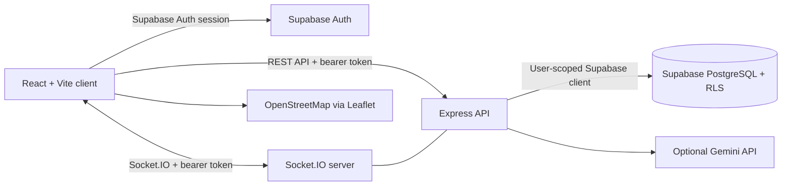

# Architecture

The React client owns Supabase email/password sign-up, sign-in, sign-out, and session restoration. Express validates Supabase access tokens and scopes each database client to the authenticated user's token; PostgreSQL Row Level Security applies to API and direct data access. Request assignment and lifecycle changes use authorization-checked PostgreSQL functions. Socket.IO verifies the same Supabase session and limits chat to participants. The optional AI provider key is read only on the server.

## Security and configuration

Client configuration uses `VITE_SUPABASE_URL` and `VITE_SUPABASE_ANON_KEY`; server configuration uses `SUPABASE_URL` and `SUPABASE_ANON_KEY`. The publishable/anon key is intended for browser use and is not a privileged key. Never put Supabase secret or `service_role` keys in client environment variables. The server deliberately uses a caller-scoped client rather than a privileged database key. Public request responses round coordinates and replace labels with `Approximate area`; exact location labels are not selectable by authenticated clients.

Run the SQL migration in `supabase/migrations` before starting the application. Configure `GEMINI_API_KEY` only in the server environment if AI features are enabled.
