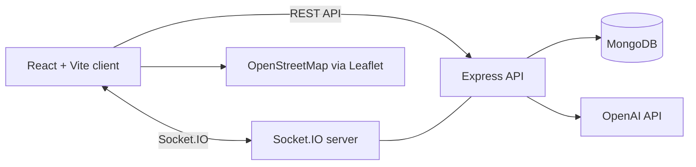

# Architecture

The React client handles request creation and discovery. The Express API validates and persists changes, while Socket.IO broadcasts request events to connected nearby clients. MongoDB is chosen for flexible request documents and geospatial queries. The AI provider is optional and accessed only from the server.

## Initial modules

- `client`: presentation, maps, forms, API client, socket client
- `server/src/routes`: HTTP endpoints
- `server/src/services`: request and AI business logic
- `server/src/socket`: real-time event registration
- `server/src/models`: Mongoose schemas

## Security baseline

Secrets stay in local environment files. Server-side validation is mandatory even when the client validates inputs. Production deployment will restrict CORS origins, rate-limit mutation endpoints, and store only approximate public locations.
