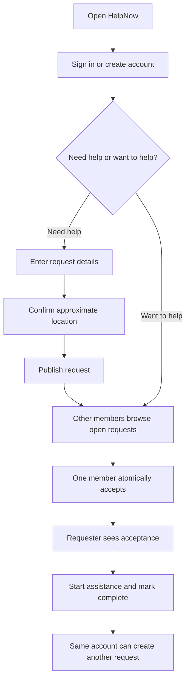

# User flow

Each member uses one account for requesting and helping. Exact location data is not shown publicly; the current app does not measure helper distance or availability. For immediate danger, contact local emergency services.
